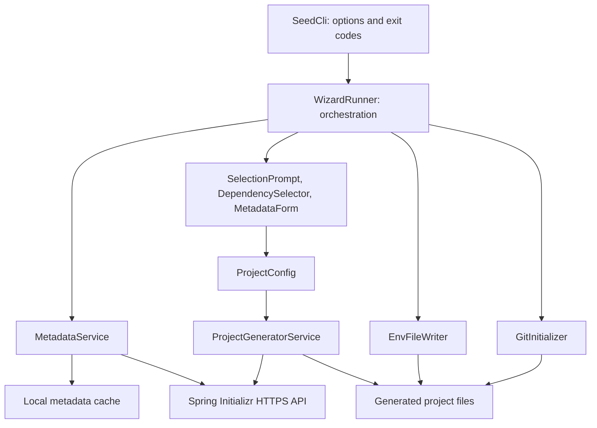

# Seed — Code Review & First-Release Readiness

**Reviewed:** 2026-09-30  
**Baseline:** local branch `Ref/All_Project`, commit `9311862` (`fix overwrite given path bug`)  
**Verdict:** **request changes before publishing a supported public release.**

This is a review, not an implementation change. Findings are assessed against a small, interactive developer CLI—not an enterprise backend.

## 1. Overview

Seed scaffolds Spring Boot projects through Spring Initializr. It fetches and caches metadata, guides the user through numbered prompts and dependency search, downloads a generated ZIP, and optionally changes configuration format, creates `.env` templates, and initializes Git with an initial commit.

### Scope and architecture

The review covered **all 17 production Java files and all 10 test Java files**, approximately **2,871 Java lines**, plus `pom.xml`, `.sdkmanrc`, `.gitignore`, `LICENSE`, and native-image reflection configuration. An independent pass read every test, ran the build and packaged-entry-point checks, and reproduced several defects locally.

The installed Java review skill references `references/checklist.md`, but that file is absent from the installed skill directory. Its available workflow and the code-review skill were applied, with correctness, architecture, performance, simplicity, security, readability, tests, and build/distribution checked explicitly.

This is a plain Java CLI using Picocli, Jackson, Jansi, Java's HTTP client, Maven Shade, and an optional GraalVM profile. There is **no Spring runtime, database, controller layer, or JPA** in Seed itself; Spring is in the projects it generates.

Important flows:

1. **Metadata:** load and validate cache → use it for one hour, or fetch/validate/cache fresh metadata → fall back to valid stale metadata on an `IOException`.
2. **Generation:** collect configuration → encode query parameters → download ZIP → refuse nonempty destination → extract → adjust Maven version if necessary.
3. **Customization:** normalize config format → optionally add `.env` and an import → optionally run `git init`, `git add`, and `git commit` → print summary.

The separation is appropriate and the implementation is not excessively abstract. The main weakness is that integration behavior is much less tested than small helpers. The tool builds successfully, but generated wrapper permissions, configuration integrity, archive validation, and optional Git failure handling need attention before users rely on it.

### Severity and evidence

- **P1 — release gate:** broken advertised behavior or essential distribution/reliability work to complete before a supported release.
- **P2 — important:** resilience or usability improvement; fix before release where noted, otherwise document and schedule.
- **P3 — optional:** cleanup or improvement that should not delay a useful first release.

No confirmed P0 remote exploit or catastrophic data-loss issue was established. “Reproduced” below means a local synthetic fixture/probe—not a live Initializr integration test.

## 2. Correctness & Release Blockers

### R1. P1 — generated Maven/Gradle wrappers are not executable on Unix

**Where:** `src/main/java/dev/ayman/seed/service/ProjectGeneratorService.java:184–201`.

`extractZip()` creates files with `Files.write()` and does not restore executable permissions. A locally constructed ZIP containing an executable `mvnw` was extracted with `Files.isExecutable(...) == false`.

**Impact:** the standard first command, `./mvnw` or `./gradlew`, can fail with `Permission denied`. A scaffolder should produce a project whose supplied build wrapper can run.

**Fix:** explicitly restore execution permission for recognized root-level build wrappers on supported Unix-like platforms; preserve unrelated files' permissions conservatively. Do not make every extracted file executable. Test both wrappers, plus platform-appropriate handling where POSIX permissions are unavailable.

### R2. P1 — invalid/empty archive bodies can be reported as generated projects

**Where:** `src/main/java/dev/ayman/seed/service/ProjectGeneratorService.java:56–62,169–205`; `src/main/java/dev/ayman/seed/wizard/WizardRunner.java:127–150`.

`ZipInputStream.getNextEntry()` can return `null` for non-ZIP bytes. No check establishes that any project content was extracted. Passing `not a ZIP` to extraction returned normally and created an empty directory.

**Impact:** a malformed HTTP 200 response can proceed to customization and success messages. Later failures can also leave a partly generated directory which the next attempt refuses as nonempty.

**Fix:** validate that the response is a usable project archive; require the expected build file/wrapper for the selected project type. Generate and customize in a newly created staging directory, then publish the completed project only after validation. On failure, clean up only tool-owned staging content, never an existing user directory. Preserve the existing overwrite refusal, and make concurrent destination creation fail rather than overwrite.

**Tests:** invalid bytes, empty ZIP, truncated/corrupt ZIP, normal nested entries, ZIP-slip rejection, failure after some entries, and a destination appearing before publication.

### R3. P1 — YAML `.env` patching is not idempotent and can duplicate `spring:`

**Where:** `src/main/java/dev/ayman/seed/util/EnvFileWriter.java:38,156–161,188–193`.

`appendIfMissing()` searches for the literal string `spring.config.import`, but the YAML block it appends represents that property as nested keys. Two calls with `useYaml=true` append two top-level `spring:` mappings. One call on YAML that already contains a nested `spring.application` block also adds a second `spring:` mapping.

**Impact:** duplicate YAML mapping keys may be rejected by the loader, or existing configuration may be discarded by permissive parsers. Current repeat-call tests only cover properties format.

**Fix:** merge the import into the existing YAML mapping and preserve other settings/imports, using an explicit config representation and an appropriate parser if supporting arbitrary YAML. If keeping v0.1 deliberately narrower, operate only on recognized freshly generated config and fail safely on unsupported input. Detect existing imports semantically, not by a text substring.

**Important scope:** this does **not** prove every fresh YAML project fails. `spring.application.name: "demo"` is a dotted key, distinct from a separate nested `spring:` mapping. The reproduced defects are repeated YAML patching and patching existing nested `spring:` content.

### R4. P1 for the advertised conversion feature — valid properties syntax can be changed, then deleted

**Where:** `src/main/java/dev/ayman/seed/util/EnvFileWriter.java:91–100,114–148`.

The converter splits physical lines at the first `=` or `:`. Java properties also support whitespace separators, escaped separators, escapes, and continuations.

**Reproduced examples:**

- `server.port 8080` becomes `server.port 8080: ""`, rather than a `server.port` value of `8080`.
- `message=Hello\nWorld` has an actual newline when loaded as Java properties, but conversion preserves the backslash sequence as literal characters in YAML.
- The source properties file is removed after conversion.

**Impact:** the promise that real configuration is preserved is not true for all valid input. Normal Initializr defaults are simpler, so this is not evidence that all generated projects are broken.

**Fix:** choose and enforce the supported boundary. For general conversion, load according to properties semantics and serialize valid YAML, verifying equivalent effective values before deleting the original. For a minimal first release, support only the exact fresh template syntax and reject anything else without deletion. Test decoded values, not merely whether output contains expected strings.

### R5. P1 integration fix — different readers consume each other's wizard input

**Where:** `src/main/java/dev/ayman/seed/wizard/SelectionPrompt.java:22–25`; `DependencySelector.java:31–35`; `MetadataForm.java:17–21`; construction in `WizardRunner.java:31,85–92`.

Each component constructs its own buffered reader around `System.in`. An earlier reader can prefetch answers that a later component needs.

**Reproduced:** the packaged CLI, supplied a valid fresh local metadata cache and 30 blank input lines together, accepted the first three defaults, then exited **130** at dependency selection despite more supplied answers. No network call was needed.

**Impact:** piped answers fail, and multi-line paste can encounter the same buffering problem. Component tests with isolated readers cannot catch it. This is not a claim that manually entering one answer at a time fails.

**Fix:** create one reader and one output writer at the composition boundary, and pass them through every interactive component. Add a complete multi-step wizard test. A new terminal framework or noninteractive command mode is not required.

### R6. P1 release reliability — optional Git work can hang or hide successful generation

**Where:** `src/main/java/dev/ayman/seed/util/GitInitializer.java:21–39`; `src/main/java/dev/ayman/seed/wizard/WizardRunner.java:119,142–150`.

The prompt asks only to initialize Git, but implementation also stages everything and makes a commit. Errors and output are discarded; `waitFor()` has no timeout. A missing Git executable/identity or a failing commit aborts the whole wizard after the project already exists. Signing or hooks can block the process.

**Impact:** a common first-time setup issue looks like total generation failure, with no final summary and little diagnostic help. Git initialization is enabled by accepting the default yes answer.

**Fix:** label the operation accurately or separate initialization from committing. Bound subprocess time and retain a limited useful diagnostic. Treat optional Git failure as a warning with the generated project location and recovery instructions; document the exit-status contract. Test missing Git, missing identity, failed command, timeout, and successful initialization without changing global Git configuration.

## 3. Architecture & Design

### A1. P2 — injectable boundaries are needed, not a bigger framework

**Where:** constructors in `WizardRunner`, `MetadataService`, `ProjectGeneratorService`, and `MetadataForm`.

Production construction is tightly coupled to actual HTTP clients, static cache location, terminal streams, and Git execution. This explains why tests concentrate on helper methods rather than the complete flow.

**Move:** retain simple default constructors for the real CLI, and add small constructor seams for HTTP/base URI/cache path, shared input/output, and the wizard's collaborators. Keep orchestration in `WizardRunner`, archive/file behavior in the generator, and format handling in `EnvFileWriter`. Do not introduce Spring DI or a repository/service-interface hierarchy merely for testing.

`ProjectConfig` currently resides in `wizard` although the generator consumes it. Moving it into a neutral model/config package is optional; it is not a release blocker and should not precede correctness work.

### A2. P2 — generation and optional customization need explicit failure boundaries

**Where:** `WizardRunner.java:126–150`; `ProjectGeneratorService.java:45–63`.

The wizard prints “Project generated” before all promised customization finishes. Use staging for mandatory generation/config steps, publish the result, then report optional Git status independently. A simple outcome containing the project path and warnings is enough; a workflow engine is not justified.

## 4. Performance & Resource Use

### P1. P2 — bound archive/download expansion rather than loading everything unchecked

**Where:** `ProjectGeneratorService.java:56,200`; `MetadataService.java:105,109`.

Both HTTP bodies are buffered fully; each ZIP entry is also read fully before writing. Normal scaffolds are small, so no measured normal-workload slowdown was found. However, there is no compressed-body, entry-count, per-entry, or total expanded-size limit.

**Fix:** apply generous documented limits appropriate for generated starters and stream entries to staging with byte accounting. Ensure any streaming HTTP approach has a bounded body-consumption lifecycle; do not accidentally remove timeout protection. No asynchronous HTTP redesign is needed for this sequential CLI.

### P2. P3 — fuzzy matching is suitable for this catalog; tiny optimizations can wait

`FuzzyMatcher.java:85–104` allocates a full Levenshtein matrix for each candidate token. A length-difference check and two-row implementation would reduce work for long queries. There is no benchmark demonstrating a release-blocking search slowdown; leave optimization until after correctness unless a realistic catalog/query benchmark shows otherwise.

No DB/N+1, pagination, transaction, or web-thread findings apply to this tool.

## 5. Simplicity & Unnecessary Complexity

The number of classes and boundaries is reasonable. The model POJOs are verbose but serve Jackson mapping; switching all of them to records or adding Lombok does not unblock release. The generic `SelectionPrompt.select()` removes genuine duplicated prompt logic, and `FuzzyMatcher` is a straightforward focused utility.

**P2 — contain temporary upstream compatibility policy.** `WizardRunner.java:59–80,179–209`, `Option.java:16–19`, and `ProjectGeneratorService.java:84–92,142–159,222–237` encode version/suffix and Gradle/BOM workarounds. Comments and warnings describe upstream behavior as current fact, but that was **not reverified against the live service in this review**. Date/document the verified upstream condition, test the filtering policy directly, and periodically recheck it. The detection of unstable versions misses release-candidate qualifiers. Do not blindly remove workarounds just because they look unusual, or present a historical upstream outage as permanent.

For v0.1, avoid unrelated architecture rewrites, new dependency-management systems, a terminal UI rewrite, or simultaneous distribution to many package managers.

## 6. Security & Dependency/Artifact Handling

### S1. P1 distribution gate — include Seed's license and intentional dependency notices

**Where:** `LICENSE:3–13`; `pom.xml:94–98`.

The source repository is MIT-licensed, but the built shaded JAR contains no copy of Seed's MIT license or author copyright text. Its `META-INF/LICENSE` is a dependency's Apache license. A scan of every complete JAR entry found neither the root license content nor `Ayman Hazem`.

Shade also warns about overlapping Jackson license/notice resources and uses first-wins content. At least one selected notice is shorter than another dependency's notice; some additional attribution files remain, so this is **not** a finding that all third-party attribution was removed.

**Fix:** include Seed's license in the downloadable distribution/JAR and deliberately preserve distinct dependency licenses/notices or merge them correctly. Review the actual artifact, not just source-root files. This is packaging/compliance work, not a claim of a security exploit or a legal opinion.

### S2. P2 — preserve existing protections and strengthen publication safety

Positive protections exist: HTTPS endpoints, URL-encoded request values, normalized ZIP path containment, nonempty-destination refusal, and `.env` exclusion before staging files for Git. Do not lose these during fixes.

The check-then-write extraction currently does not establish exclusive ownership of the destination; another writer can create matching files after the emptiness check, and default writes can truncate them. Staging plus no-overwrite publication addresses this more robustly. Treat download/metadata content as external input and add malformed-input tests and limits, without overstating a malicious-server threat.

### S3. P2 release verification — dependency vulnerabilities remain unassessed

Direct dependency versions are pinned, but this review did **not** run a current vulnerability advisory scan or certify that dependencies are vulnerability-free. Run a dependency/SBOM/license review before publishing and triage reachable findings. Upgrade individually with tests and changelog review; do not bulk-update everything as a release-preparation shortcut.

No API key or bundled real credential was found in the reviewed source/config files. `.env` templates contain commented examples. This does not substitute for a full Git-history secret scan. Authentication/authorization is not needed for this local CLI's current design.

## 7. Code Quality & User-Facing Behavior

### Q1. P2 — cache write failure should not invalidate a good network response

**Where:** `MetadataService.java:61–71,109–115`.

Valid fetched metadata is only returned after persistence succeeds. A read-only/unavailable cache causes first-run failure despite a successful fetch; if stale metadata exists, a write failure can cause that stale content to be returned instead of the freshly fetched content.

**Fix:** treat persistence as best effort, return validated fresh metadata, warn when caching fails, and write cache replacements atomically. Make stale fallback visible, including under `--refresh`, so the user knows generation may still require current service metadata. Inject the cache path to test this without touching the real home directory.

### Q2. P2 — malformed metadata can escape validation with unchecked exceptions

**Where:** `MetadataService.java:49–58,123–155`; rendering in `SelectionPrompt.java:66`; dependency traversal in `WizardRunner.java:218–225`.

A null element in otherwise valid project-type options causes `validate()` to throw `NullPointerException`; cache recovery catches only `IOException`. Other selectable IDs/names and dependency entries also have incompletely enforced assumptions.

**Fix:** explicitly reject null elements and missing required fields with descriptive validation exceptions, then let malformed-cache recovery proceed. Add negative metadata fixtures; do not broadly swallow runtime exceptions as if every programmer bug were invalid cache.

### Q3. P2 — validate metadata choices locally and describe `.env` accurately

**Where:** `MetadataForm.java:34–55`; `ProjectConfig.java:157–160`; `WizardRunner.java:157–164`; `EnvFileWriter.java:14–38`.

Artifact path traversal is checked, but invalid identifiers/package components are not reprompted. Sanitizing an artifact such as `123-app` can produce a package component starting with a digit. Provide immediate, actionable validation for supported identifiers instead of making users finish the wizard before a server rejection.

The generated `.env` is imported as **Java properties**, not sourced as a shell script. `export`, shell expansion, and shell quoting must not be advertised as supported. `DATABASE_URL` is an example property; it does not automatically configure `spring.datasource.url` without matching configuration/placeholders. Document this contract in the README/template.

### Q4. P3 — align terminal behavior and comments with the implemented UI

`DependencySelector.java:13–20` claims per-character live search and describes arrows, but input is line-based and search runs after ENTER. Correct this documentation. Numeric selection accepts any index in the full filtered list (`79–89`) although only 12 are displayed (`147–184`); constrain choices to displayed results and report invalid indices rather than silently ignoring them.

Use locale-independent case normalization (`Locale.ROOT`) for identifiers and yes/no/search comparisons. Offer a plain/no-color path for redirects or unsupported terminals and check narrow terminal readability. Picocli help uses automatic color handling, but wizard output is built separately with Jansi.

## 8. Testing & Build Validation

### What actually ran

| Validation | Observed result |
|---|---|
| Environment | Linux amd64; OpenJDK 25.0.2; Maven 3.9.11 |
| `mvn -o clean verify` | **Passed**; 58 tests, 0 failures, 0 errors, 0 skipped; approximately 13 seconds |
| `java -jar target/seed-1.0.0.jar --help` | Exit 0; usage on stdout |
| `java -jar target/seed-1.0.0.jar --version` | Exit 0; `seed 1.0.0` |
| Invalid option `--definitely-invalid` | Exit 2; diagnostic/usage on stderr |
| JAR inspection | Correct `Main-Class`; approximately 3.07 MB; Java class-file version 69 (Java 25) |
| Local probes | Confirmed R1–R5 and Q2 using synthetic fixtures; no live Initializr contact |
| GraalVM availability | Installed 25.0.4 tool reports its version; **native compilation not attempted** |

The existing suite has useful regression assertions but is not yet a sufficient release gate.

### Full test inventory and important gaps

All paths below are relative to `src/test/java/dev/ayman/seed/`.

| File | Tests | Assessment |
|---|---:|---|
| `DependencySelectorTest.java` | 3 | Good search-reset/overflow regressions; missing deselect, clear/done, EOF, empty search results and visible-index boundaries. |
| `EnvFileWriterTest.java` | 7 | Checks migration substrings and properties idempotency; no parsed-value equivalence, YAML repeat/merge test, or `.gitignore` assertion. Existing secret preservation is tested. |
| `FuzzyMatcherTest.java` | 10 | Score cases covered; `idContainsQueryScores50` only asserts `>=40` with a name-matching fixture. “Sorted results” uses equal-score names and does not assert order. |
| `MetadataParserTest.java` | 7 | Happy-path metadata mapping; missing malformed/null entries and optional/unknown-field cases. |
| `ProjectConfigTest.java` | 4 | Mostly getter/setter assertions; `derivePackageName()` edge cases are untested. |
| `SeedCliTest.java` | 2 | Path-alias parsing only; packaged behavior was manually checked, not gated by these tests. |
| `SelectionPromptTest.java` | 8 | Yes/no handling only; numbered option selection/default/invalid input is untested. |
| `service/MetadataServiceTest.java` | 1 | Only accepted metadata shape; no actual fresh/stale/corrupt-cache, refresh, HTTP, or cache-write behavior test. |
| `service/ProjectGeneratorServiceTest.java` | 9 | Useful overwrite/version/error-message cases; no HTTP flow, executable mode, invalid ZIP, ZIP-slip, rollback, or complete encoded query-map assertion. |
| `wizard/WizardRunnerTest.java` | 7 | Good output-path safety; warning test reconstructs a condition instead of executing the wizard. No end-to-end flow or direct `selectableBootVersions()` policy tests. |
| **Total** | **58** | Passing, but missing core integration and failure-path coverage. |

`MetadataForm` and `GitInitializer` have no dedicated behavior tests. Prioritize the above release risks over raw coverage targets or more accessor tests.

### Build and distribution gaps

- **No README, CI workflow, Maven wrapper, changelog, or user-facing release/install instructions are present in the current checkout.** Existing Git history is not evidence that those files currently exist.
- POM and CLI both hardcode `1.0.0`; HTTP user agents separately say `seed-cli/1.0`. Centralize release identity and verify version output from the actual artifact.
- The JAR requires **Java 25+**. Seed's runtime requirement is distinct from the Java version chosen for a generated Spring project. Keep 25 if intentional and document it; lowering it requires code/build changes and testing, not just changing the README.
- The native profile and reflection hints exist, including generated Picocli hints. A functioning native release is **unverified**; do not promise native/platform binaries yet.
- Shade loses `Multi-Release: true` while versioned Jackson classes remain. Their version-specific implementations will not be selected. Make the manifest behavior intentional and test Jackson parsing in the packaged artifact.
- Root license packaging and dependency notices need S1. Publication metadata (`licenses`, URL, SCM, developers) is absent; Maven Central requirements matter only if Maven Central is chosen as a distribution channel.
- Build emitted Shade overlap warnings, a compiler processor-option warning, and Maven/Guice deprecation output. A wizard probe also emitted Jansi's restricted-native-access warning on JDK 25. Investigate/document actionable runtime warnings; do not silence them indiscriminately.
- A successful offline build uses already cached dependencies. It does **not** prove a clean public CI environment can resolve and reproduce the release.

**Not verified:** live Initializr compatibility, generated-project compilation/startup, native image, macOS/Windows operation, fresh-machine installation, current dependency advisories, or full Git-history secrets.

## 9. What's Done Well

- **Existing files are protected in the normal single-process path:** nonempty-destination refusal has a regression test that verifies original content remains intact.
- **Output path handling is explicit:** projects are artifact-named children of the requested parent, with separator and traversal tests.
- **ZIP containment is checked:** normalized absolute paths are compared before writing; add a test to keep this guard intact.
- **Network requests are bounded:** connection/request timeouts and structured generation errors are already present.
- **Metadata is validated before use/cache, with valid stale fallback:** the policy is useful; malformed-element and persistence boundaries need strengthening rather than a rewrite.
- **Secret-safe defaults in file handling:** existing `.env` content is preserved, and generated `.env` is added to `.gitignore` before Git staging.
- **CLI status behavior is clear at the entry point:** success, general error, cancellation, and invalid argument use distinct exit codes; packaged help/version work.
- **Complexity is proportionate:** small focused services/utilities, a reusable numbered prompt, no unnecessary Spring/ORM dependencies, and useful bug-focused tests.
- **The project already builds a runnable fat JAR offline:** release engineering can build on this rather than replacing the build system.

## 10. Prioritized Action Plan

The detailed execution checklist and acceptance criteria are in [PUBLIC_RELEASE_PLAN.md](PUBLIC_RELEASE_PLAN.md).

| Order | Action | Effort | What it unblocks |
|---|---|---|---|
| 1 | Freeze scope/version/runtime/platform commitments; start README with the actual contract. | Small | A realistic release target and no unsupported promises. |
| 2 | Fix wrapper permissions and validate/stage extraction with no-overwrite publication (R1/R2). | Medium | Generated projects are usable and failures do not look like success. |
| 3 | Fix YAML import merging/idempotency and safe properties conversion (R3/R4). | Medium | Trustworthy advertised config customization. |
| 4 | Share terminal input/output and add a whole-wizard fixture test (R5). | Small–medium | Reliable multi-step interaction and testability. |
| 5 | Make optional Git work bounded, truthful, and recoverable (R6). | Small–medium | A usable first-run experience without preconfigured Git identity. |
| 6 | Add service seams and fix cache persistence/null-validation boundaries (A1/Q1/Q2). | Medium | Offline failure-path tests and resilient network/cache behavior. |
| 7 | Include license/notices, centralized version metadata, dependency audit, and clean CI/JAR smoke gates (S1/S3). | Medium | A publishable, attributable, repeatably verified artifact. |
| 8 | Document install/privacy/cache/output/.env behavior; pilot real Maven and Gradle generated builds on supported platforms. | Medium | A supportable first public release with end-to-end evidence. |
| 9 | Publish only after all required gates pass; defer native/package-manager expansion and cosmetic refactors. | Small | A focused release without unnecessary scope growth. |

Effort categories are estimates, not deadlines: small ≈ a few hours, medium ≈ one or more focused working sessions. No implementation fixes, dependency upgrades, commits, tags, or publication were performed by this review. The pre-existing `AD plan-springSeed.prompt.md` Git state was preserved.
